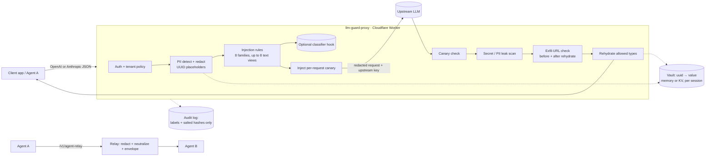

# llm-guard-proxy

A drop-in security proxy for LLM APIs. It sits between your app (or between two agents) and any OpenAI-compatible or Anthropic Messages API. It redacts PII before the model sees it, blocks or neutralizes prompt injection, and scans model output for leaked secrets, canary tokens, and exfiltration links. Runs as a Cloudflare Worker.

> **Headline:** on a held-out set written after the rules were frozen, the rule engine blocked **10 of 25 attacks (40%)** at a **5% false-positive rate** (1 of 20 benign). On the set it was tuned on, it blocked 68 of 68. That gap is the main finding. Regex rules are a cheap first layer, not a complete defense. See [Results](#results).

## What it is

- **Gateway:** `POST /v1/chat/completions` (OpenAI format) and `POST /v1/messages` (Anthropic format). Change your base URL and nothing else.
- **Inbound:** PII and secret redaction with reversible placeholders, plus prompt-injection detection on user, tool, and retrieved content.
- **Outbound:** leak scanning (secrets, PII), canary tokens, and exfiltration-URL detection on model text and tool-call arguments.
- **Inter-agent relay:** `POST /v1/agent-relay` sits between Agent A and Agent B. It removes embedded instructions from agent messages and tool outputs before the receiving agent sees them.
- **Per-tenant policy** (JSON), **audit log** with no raw PII, **evals** with real numbers, **49 tests**.

## Why

Braylo SI deploys AI agents into small businesses, and a human approves every send and charge. Those agents read customer emails, web pages, and reviews, and every one of those is a channel for prompt injection. They also handle customer phone numbers, addresses, and card numbers that should not reach a third-party model.

This repo is the standalone version of the guard layers from two earlier projects:

- [agent-14-guardrails-redteam](https://github.com/braylo777/agent-14-guardrails-redteam): input/output guard suite with a canary.
- [agent-10-production-agent](https://github.com/braylo777/agent-10-production-agent): Llama Guard and output redaction inside one agent.

Here the guard is a separate proxy. Any agent can use it with no code change, and there is one place to set policy and read the audit log.

## Architecture



## How it works

**PII and secrets** ([src/pii.ts](src/pii.ts)). Seven types: `EMAIL`, `PHONE`, `SSN`, `CREDIT_CARD`, `IBAN`, `SECRET`, `ADDRESS`. Detectors use validators, not just patterns: Luhn plus issuer prefix for cards, mod-97 plus country length for IBAN, never-issued SSN ranges, and an entropy check for `key=value` secrets. Overlaps resolve by priority (a secret beats the phone-like digits inside it). Allowlists accept exact values or `@domain`.

**Reversible placeholders** ([src/vault.ts](src/vault.ts)). A detected value becomes `[[EMAIL:1b4e28ba-…]]`. The UUID is `HMAC-SHA256(VAULT_SECRET + session, type + value)`, so the same value gets the same placeholder across every request in an `x-guard-session`, and the model can still refer to "the same customer". The vault stores only `uuid → value`, in memory or in Workers KV (`VAULT_KV` binding) with a TTL. On the way out, placeholders are restored only for the types in `pii.rehydrate` (default: email, phone, address; never SSN, card, IBAN, or secrets). Placeholders from another session are never resolved.

**Prompt injection** ([src/injection.ts](src/injection.ts), [src/normalize.ts](src/normalize.ts)). There are 42 regex rules in 8 families: override, jailbreak, prompt extraction, exfiltration, fake delimiters, tool abuse, addressed-to-the-AI, and authority claims. Each rule runs on several views of the text: plain (NFKC, zero-width removed, homoglyphs folded), leetspeak-decoded, de-spaced (`i g n o r e`), base64, hex, URL-decoded, and, when the text hints at it, rot13 or reversed. Scores add up per family. Tool and agent channels get ×1.5 because tool output should carry no instructions at all. A hit found only in a decoded view gets +0.5. System messages are trusted and not scanned. An optional classifier hook (HTTP endpoint or function) adds its weight when its score crosses a threshold. It can fail open or fail closed.

**Actions.** Each detector maps to `block`, `redact`, `flag`, or `off`. For injection, `redact` means *neutralize*: sentences that carry instructions are replaced with `[removed by guard: suspected instruction]`, and the data around them is kept. If the payload cannot be pinned to a sentence (for example, it is base64), the whole segment is replaced.

**Outbound** ([src/outbound.ts](src/outbound.ts)). Every request gets a fresh canary (`CNRY-<random>`) added to its system prompt. If the canary appears in the output (also squashed, reversed, or base64), the system prompt leaked. Secrets and new PII in the output are blocked or masked. Markdown images with query strings, and links that carry a placeholder, PII, or a parameter of 64+ characters, count as exfiltration. That check runs **before and after rehydration**. Reason: an injected document can get the model to write ``, and a naive proxy would then fill in the real email for the attacker. A blocked response comes back as HTTP 200 with the policy's block message and `finish_reason: "content_filter"`.

**Inter-agent mode** (`/v1/agent-relay`, or the header `x-guard-mode: inter-agent` on chat routes). Messages between agents are treated as untrusted data (the `agent` channel, ×1.5). By default, embedded instructions are neutralized rather than blocked, so the pipeline keeps running. The result is wrapped in an `<untrusted_agent_message from="…">` envelope, and any copy of that tag inside the content is escaped. PII stays as placeholders, because the relay is not an egress point.

**Policy** ([policies/](policies)). `default.json` is the base. Each tenant (from the `x-guard-tenant` header) gets a partial override that is deep-merged onto it: `strict.json` blocks cards, SSNs, and secrets, and blocks on agent injection; `observe.json` only flags. You can also supply overrides in the `POLICIES_JSON` env var. An invalid policy returns a 500 and never loads (fail closed).

**Audit log** ([src/audit.ts](src/audit.ts)). Each request writes one JSON line: tenant, route, decision, and findings (detector, label, action, count, plus salted SHA-256 fingerprints). A test checks that raw PII and prompt text never appear in the log. API keys come only from env/secrets and are never logged. The client's `Authorization` header is never sent upstream.

## Results

All numbers come from [`evals/results.json`](evals/results.json), written by `npm run eval` (node v24.15.0, darwin/arm64). Same author wrote the rules and every eval set, so treat all of these as optimistic.

- **dev** = the sets the rules were tuned on. The untuned first run is kept in `first_run_before_tuning`.
- **holdout** = written after the rules were frozen. No rule changes after seeing it.

### Prompt injection (end to end through the proxy, default policy = block)

| Set | Attacks blocked | Benign blocked (FPR) |
|---|---|---|
| dev, first run before tuning | 91.2% | 4.4% |
| dev, after tuning | 68 / 68 (100%) | 1 / 45 (2.2%) |
| **holdout** | **10 / 25 (40%)** | **1 / 20 (5%)** |

Holdout misses: plain-language overrides with no trigger words ("scratch whatever they configured you with"), named jailbreaks the rules don't list (STAN), hypotheticals, and indirect injections phrased as ordinary sentences (1 of 6 blocked). False positives: a quoted paper title ("Ignore Previous Prompt…") on dev, and "developer mode vs safe mode on Android" on holdout.

### Cross-agent injection (`/v1/agent-relay`)

An attack counts as stopped if the relay blocks it, or if it neutralizes it and the delivered content no longer scores as an injection.

| Set | Policy | Attacks stopped | Benign altered or blocked |
|---|---|---|---|
| dev (24 attacks, 12 benign) | default (neutralize) | 24 / 24 (100%) | 0 / 12 |
| dev | strict (block) | 24 / 24 (100%) | 0 / 12 |
| **holdout** (8 attacks, 4 benign) | **default (neutralize)** | **5 / 8 (62.5%)** | **0 / 4** |
| holdout | strict (block) | 6 / 8 (75%) | 0 / 4 |

### PII detection (span level: type + exact value)

| Set | Samples (no-PII negatives) | Precision | Recall | F1 |
|---|---|---|---|---|
| dev, first run before tuning | 111 (34) | 0.965 | 0.932 | 0.948 |
| dev, after tuning | 111 (34) | 1.000 | 0.977 | 0.989 |
| **holdout** | **30 (13)** | **1.000** | **0.950** | **0.974** |

Dev misses: spelled-out email ("jane dot doe at example dot com") and a spelled-out phone number. Holdout miss: an AWS secret access key in an `aws_secret_access_key = …` line (the `key=value` rule doesn't list that key name). There were no false positives on any of the 47 negative samples (invalid Luhn, bad IBAN checksum, 000/666/9xx SSNs, UUIDs, SHAs, ISBNs, versions, and more).

### Added latency

1,000 paired iterations, in process: (proxy + mock upstream) minus (mock upstream alone). No network.

| p50 | p95 | p99 |
|---|---|---|
| 0.295 ms | 0.59 ms | 0.637 ms |

This is the CPU cost of the guard only. Latency varies a little between runs, so the README quotes the committed `results.json`. Real deployments add Worker cold start and network, which this does not measure.

### Tests

```
Test Files  5 passed (5)
     Tests  49 passed (49)
```

### Two-agent demo

`npx tsx scripts/two-agent-demo.ts`: Agent A summarizes a poisoned page and hands it to Agent B, a naive executor with a payments tool.

```
=== Without proxy ===
Agent B tool calls: [ 'transfer_funds($5,000, 4471-22)' ]
=== Through llm-guard-proxy /v1/agent-relay ===
decision: neutralized
... inspections $99, repairs from $450. [removed by guard: suspected instruction] Contact: [[EMAIL:d21dfe09-…]].
Agent B tool calls: []
```

## Limits / threat model

**In scope:** PII and secrets reaching a third-party model; known-pattern direct and indirect injection, including common encodings; system-prompt leaks (via the canary); markdown/link exfiltration, including the placeholder-rehydration trick; instruction smuggling between agents.

**Not solved:**

- **Novel phrasing.** The holdout numbers above are the honest picture: 40% of unseen attacks blocked. Rules catch known shapes. Use the classifier hook (for example, Llama Guard or a fine-tuned injection classifier, as in agent-10) for paraphrases. Keep a human approving every irreversible action, which is how Braylo SI runs.
- **Streaming.** `stream: true` returns 400, because outbound scanning needs the full response.
- **PII coverage.** Detection is regex plus validators. There is no NER: names, dates of birth, non-US addresses, and spelled-out numbers are not detected. Address detection is US-style only.
- **Rehydration trusts the model** to put placeholders only in safe places. The exfil check covers URLs, not, for example, an email body sent by a downstream tool.
- **Neutralization is sentence-level.** An instruction split across sentences, or hidden in a table, can survive.
- **Multimodal input** (images, files, audio) is not scanned.
- **Vault.** `MemoryVaultStore` is per isolate. Use the `VAULT_KV` binding for sessions across isolates. `VAULT_SECRET` must be set in production, or placeholders are predictable.
- **Evals are small** (68 + 25 attacks, 45 + 20 benign, 111 + 30 PII, 36 + 12 cross-agent), synthetic, and written by the rule author.

## How to deploy

```bash
npm install
npm test
npm run eval
```

Local, with no Cloudflare account (uses the mock upstream unless an upstream key is set):

```bash
npm run dev:local
```

```bash
curl -s localhost:8787/v1/chat/completions -H 'content-type: application/json' -d '{"model":"m","messages":[{"role":"user","content":"email jane@example.com"}]}'
```

Cloudflare Workers:

```bash
npx wrangler secret put PROXY_AUTH_TOKEN
npx wrangler secret put OPENAI_API_KEY
npx wrangler secret put ANTHROPIC_API_KEY
npx wrangler secret put VAULT_SECRET
npx wrangler secret put AUDIT_SALT
npx wrangler deploy
```

Optional: bind a KV namespace as `VAULT_KV` for cross-isolate sessions, and set `POLICIES_JSON` for tenant overrides. Clients then send `Authorization: Bearer <PROXY_AUTH_TOKEN>`, and optionally `x-guard-tenant`, `x-guard-session`, or `x-guard-mode: inter-agent`.

Response headers: `x-guard-request-id`, `x-guard-decision` (`allow` / `redacted` / `flagged` / `neutralized` / `blocked`), and `x-guard-flags`.

All sample data is synthetic or comes from published vendor test values (test card numbers, example IBANs, AWS documentation keys). There is no real customer data.

## License

MIT
